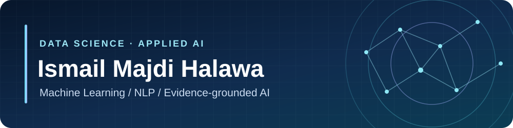

  

  
  

<strong>Turning unstructured data into useful, evidence-backed insights.</strong>

---

### About me

I'm a **Data Science graduate from Jordan University of Science and Technology** focused on applied AI, machine learning, and natural language processing. I enjoy building systems that connect data preparation, model inference, and clear results people can act on.

- **Current focus:** multilingual NLP, sentiment analysis, and retrieval-augmented applications.
- **Currently building:** **InsightForge AI**, a private project in development that analyzes feedback from multiple sources and presents findings with supporting evidence.
- **Open to:** Junior AI Engineer, Junior ML Engineer, and related applied AI roles.

### Selected projects

**[SentimentPro →](https://github.com/ismailhalawa-ctrl/SentimentPro-youtube)**  
YouTube comment analysis for sentiment and audience insights, with a RAG chat over analyzed feedback.  
`Python` `Transformers` `NLP` `RAG`

**[YouTube Sentiment Analyzer →](https://github.com/ismailhalawa-ctrl/YouTube-Sentiment-Analyzer)**  
An earlier Streamlit prototype for multilingual comment analysis using MARBERT and RoBERTa.  
`Python` `Streamlit` `SQL Server`

**[Credit Card Fraud Detection →](https://github.com/ismailhalawa-ctrl/Credit-Card-Froud-Detection)**  
Anomaly detection on imbalanced transaction data with clustering and outlier methods.  
`Python` `scikit-learn` `PCA`

**[Mall Customer Analysis →](https://github.com/ismailhalawa-ctrl/Mall-Customer-Analysis)**  
Customer segmentation using clustering and dimensionality reduction.  
`Python` `K-Means` `DBSCAN`

<a href="https://github.com/ismailhalawa-ctrl?tab=repositories"><strong>View all public repositories →</strong></a>

### Tools I work with

`Python` · `SQL` · `PyTorch` · `scikit-learn` · `Hugging Face Transformers` · `pandas` · `NumPy` · `Jupyter` · `FastAPI` · `PostgreSQL`

---

Interested in applied AI work? <a href="https://www.linkedin.com/in/ismail-majdi-halawa-987aa52ab/">Connect with me on LinkedIn</a>.

